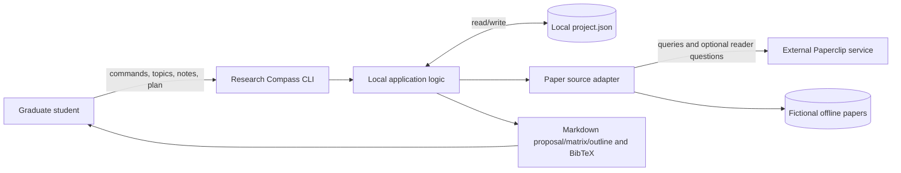
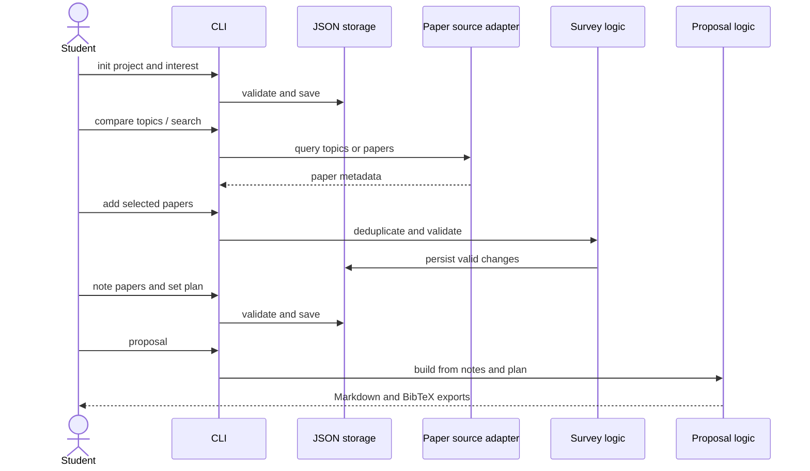
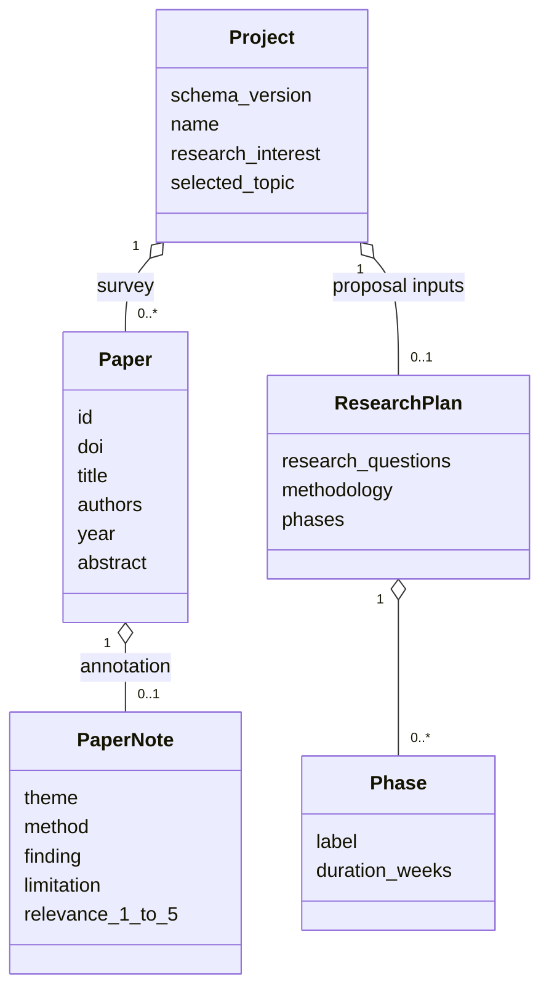

# Full Spec: Research Compass

**Team:** Zhang, Haoxuan; Byanjankar, Aayush; Rayamajhi, Dipesh; Ghimire, Sulav  
**Date:** November 19, 2026  
**Committer:** TODO: confirm the member responsible for merging `docs/FULL_SPEC.md` (documentation owner: Byanjankar, Aayush)  
**Repository:** https://github.com/haoxuan-unt2024/DTSC4565-ResearchCompass

**Roles:** Project Lead & Requirements Engineer — Zhang, Haoxuan | Software Process & Planning Lead — Byanjankar, Aayush | System Architect & Design Lead — Rayamajhi, Dipesh | Implementation Lead — Ghimire, Sulav | Testing & QA Lead — Ghimire, Sulav | Maintenance & Documentation Lead — Byanjankar, Aayush. **Prompt-engineering coordination:** Byanjankar, Aayush (proposed under process planning; TODO: confirm separately if required).

**Evidence and status convention:** The project brief supplied by the team defines intended behavior. The public repository README describes an existing implementation and reports 58 automated tests; those tests and individual code paths have **not** been independently executed or audited for this specification. “Implemented (README)” means documented, not independently verified. Future actions and suggested practices are labeled **planned**. Every section owner must verify the final wording.

---

## 0. The idea (Chapter 1)
**Owner:** Zhang, Haoxuan (Project Lead & Requirements Engineer).

**The single main problem, and for whom:** Graduate students need a repeatable, transparent way to move from a broad research interest to a structured literature survey and proposal draft without losing control over source selection and interpretation.

Research Compass is a local Python command-line application. It compares up to eight candidate topics using literature indicators, retrieves papers through Paperclip (or fictional offline fixtures), stores structured notes, reports coverage weaknesses, and exports a proposal skeleton and BibTeX references.

**Who is harmed if the app fails, is wrong, or leaks data?** The student could choose an unsuitable topic, overlook important research, submit incorrect citations, waste time, or disclose unpublished research interests or notes. Supervisors and readers could be misled by inaccurate summaries or apparent research gaps. Harm is principally academic, privacy-related, and reputational, not clinical decision-making.

**Must never do:** Commit or store an API key in project JSON; silently overwrite a project on failed validation; present generated prose or AI-reader output as verified scholarship; fabricate references or claim exhaustive literature coverage; transmit local reading notes to Paperclip without explicit design change; represent heuristic scores as objective measures of research quality.

**AI contribution:** AI helped structure the problem statement and enumerate risks. The team must confirm that the privacy boundary and non-autonomous scope match the actual implementation.

## 1. Process and plan (Chapters 2 and 3)
**Owner (Process lead):** Byanjankar, Aayush.

**Chosen process model:** Incremental development with lightweight agile practices. The CLI, offline source, scoring, survey, and proposal outputs can be delivered and tested independently, while uncertain Paperclip integration can be isolated behind an adapter.

**Practices:** Planned/verify against team records: short task board, feature branches, pull-request review, pytest on each change, end-of-sprint demonstration, and brief retrospective. TODO: record which practices actually occurred and link evidence; do not describe planned practices as historical facts.

**Definition of Done:**
- [ ] Behavior matches a numbered requirement and acceptance test.
- [ ] Relevant automated tests pass locally with the offline source.
- [ ] Invalid inputs produce an actionable message, exit status 1, and no mutation of the project file.
- [ ] CLI help/README and any changed data schema are updated.
- [ ] A second team member reviews the change, or TODO: document an approved alternative.
- [ ] No secrets, real private notes, or network dependencies enter offline tests.

**Proposed sprint breakdown (reconstruct actual history before submission):**

| Sprint | Working software at the end | se-agent run? |
|---|---|---|
| 1 | CLI initialization, versioned JSON storage, offline fixture, first tests | TODO: verify run log |
| 2 | Topic comparison/scoring, Paperclip adapter, search and survey notes | TODO: verify run log |
| 3 | Coverage checks, matrix/outline, proposal/BibTeX, end-to-end tests | TODO: verify run log |

**Biggest schedule risk:** Live Paperclip authentication, SDK changes, or service availability may delay integration. Mitigation: build and test against the offline fixture and a fake adapter; reserve live integration as a separately validated gate, not a prerequisite for local demonstration.

**AI contribution:** AI proposed the incremental sprint decomposition and Definition of Done. TODO: compare against the team's actual work history and replace proposed dates/runs with evidence.

## 2. Requirements (Chapter 4)
**Owner (Requirements Engineer):** Zhang, Haoxuan.

### Stakeholders and what each wants
| Stakeholder | Wants |
|---|---|
| Graduate student | Understandable topic comparison, organized papers, editable notes, usable draft exports |
| Faculty advisor | Traceable sources, explicit gaps, honest TODOs, no fabricated claims |
| Project team | Modular, testable Python code with an offline demo |
| Instructor/evaluator | Observable acceptance criteria, traceability, tests, engineering decisions |
| Paperclip service | Valid authenticated requests without leaked credentials |

### User stories and acceptance criteria
1. **As a graduate student**, I want to create a local research project so that my work persists. **Accept:** a name and one-line interest produce a readable versioned JSON file; malformed input leaves existing data unchanged.
2. **As a graduate student**, I want to compare 1–8 candidate topics so that I can prioritize a direction. **Accept:** each topic shows score 0–100, verdict, evidence indicators, and narrower title-phrase suggestions; fewer than five results yields `too narrow`, and at least 40% review titles yields `saturated`.
3. **As a graduate student**, I want to search and curate papers so that I can build a nonduplicated survey. **Accept:** numbered search results can be added; repeated ID, DOI, or normalized title is skipped and reported; out-of-range selection does not change the survey.
4. **As a graduate student**, I want structured notes and a literature matrix so that I can compare evidence. **Accept:** theme, method, finding, limitation, and relevance 1–5 can be recorded; invalid relevance is rejected without mutation; matrix and theme outline export correctly.
5. **As a graduate student**, I want a proposal skeleton so that I can plan my study. **Accept:** sections include introduction, themed related work with author-year citations, gap, RQs, methodology, cumulative-week timeline, references and BibTeX; missing inputs display TODO markers.

### Requirements table
| ID | Type | Testable requirement | Priority | Acceptance test |
|---|---|---|---|---|
| R1 | F | Initialize a project from a name and one-line interest in a single versioned JSON file. | Must | Valid `init` -> file loads with name/interest. |
| R2 | F | Compare 1–8 topics and display 0–100 score, verdict and four evidence indicators. | Must | Three offline topics -> federated-learning ranks first; review-heavy topic is `saturated`. |
| R3 | F | Assign `too narrow` for fewer than five hits and `saturated` for review-title share >= 0.40. | Must | Boundary fixtures at 4/5 hits and 39%/40% reviews -> correct verdicts. |
| R4 | F | Suggest narrower candidate phrases drawn from repeated search-result title phrases. | Must | Repeated title phrase -> suggestion traceable to titles. |
| R5 | F | Search via Paperclip or offline source, number results and add selected papers without ID/DOI/title duplicates. | Must | Result 99 of 20 -> exit 1 and unchanged survey; duplicate -> reported skip. |
| R6 | F | Save per-paper theme, method, finding, limitation and relevance in [1,5]. | Must | Relevance 7 -> exit 1 and unchanged project. |
| R7 | F | Export Markdown literature matrix and theme-grouped outline with a gaps section. | Must | Curated sample -> parseable table, theme headings, gaps section. |
| R8 | F | Warn about <10 papers, missing notes, singleton themes, no papers from last 3 years, or no limitations. | Must | One fixture for each condition -> matching warning. |
| R9 | F | Export proposal skeleton and BibTeX with citations, RQs, methodology, cumulative timeline and visible TODOs. | Must | Phases 4, 8, 4 -> final week 16; missing RQ -> TODO. |
| R10 | NF (reliability) | All command errors must print a clear message, exit 1 and leave existing project JSON unchanged. | Must | Invalid index, relevance, malformed file, auth failure -> unchanged bytes. |
| R11 | NF (accessibility) | Core output must be readable as plain text without relying on color, and support terminal/screen-reader use. | Must | No color-only statuses; numbered results and labels convey meaning. |
| R12 | NF (privacy) | API credentials must come from Paperclip login or environment and never be saved in repository/project JSON. | Must | Search stored project/outputs for sentinel key -> absent. |
| R13 | NF (cost/testability) | Offline mode and tests must not require network, account or paid model calls. | Must | Run suite without credentials/network -> no service call. |
| R14 | NF (maintainability) | CLI presentation, scoring, survey, proposal and storage logic must be separated and unit-testable. | Must | Fake source and module tests operate without CLI/network. |
| R15 | F | Optional AI reader saves output as visibly labeled unverified draft. | Should | AI reader output file contains unverified label. |
| R16 | F | Optional `--corpus` restricts searches to one of arXiv, PMC, bioRxiv, medRxiv. | Should | Selected corpus reaches source adapter; unsupported value rejected. |
| R17 | NF (performance) | TODO: agree a measurable local response-time budget for offline topic comparison and exports on reference hardware. | Should | Benchmark fixed fixture on documented machine against approved threshold. |

**Out of scope:** Web/mobile UI, user accounts, sharing, PDF downloads, polished final proposal prose, non-author-year citation styles, plagiarism checking, exhaustive literature review, autonomous source verification.

**Requirements removed as unnecessary:** No confirmed historical removals. Deliberately excluded from MVP: web interface and database, because one student uses a local CLI and one JSON project file. TODO: confirm whether any feature was actually removed during development.

**Open questions:** Are the scoring weights appropriate or configurable? Is Paperclip's corpus sufficient outside biomedical/arXiv disciplines? Is CLI usable for nonprogrammers? Should proposal exports follow a specific department template? What offline performance threshold is realistic?

**AI contribution:** AI converted the supplied brief into traceable IDs and boundary tests; the team must validate exact behavior and approve any newly proposed measurable requirements.

## 3. Models (Chapter 5)
**Owner (Architect):** Rayamajhi, Dipesh.

### Context model

Boundary: local notes and project JSON remain on the laptop; search queries and optional AI-reader questions may cross to Paperclip. Credentials are managed outside project data.

### Main use-case sequence

### Conceptual data model

This is a **conceptual** model, not a claim about exact Python class names or JSON keys. TODO: compare with `models.py` and a saved fixture before final submission.

**State model:** The app has no server/session lifecycle; its meaningful workflow states are project uninitialized -> initialized -> topic selected -> survey populated -> notes/plan populated -> exports available. Missing stages are allowed and must yield visible TODOs/warnings, not hidden invented content. Offline/live is a source-selection mode, not a different project state.

**Consistency check:** R10's atomic no-mutation guarantee is not obvious in the conceptual entities; it is implemented/verified at the storage boundary and tested with failure paths. R15's AI-reader file is an optional export, not part of core project state. TODO: confirm no persisted search-result state has been omitted.

**AI contribution:** AI drew the context, sequence and conceptual class models from the brief and README. The architect must reconcile these with the real code.

## 4. Architecture (Chapter 6)
**Owner (Architect):** Rayamajhi, Dipesh.

**Pattern:** Layered/modular CLI architecture with a port-and-adapter boundary for paper search. Presentation and argument parsing (`cli.py`) call domain functions (`topics.py`, `survey.py`, `proposal.py`), which use models/storage and a swappable paper source (`sources.py`).

**Non-functional drivers:** R10 requires safe writes; R11 plain-text CLI output; R12 local privacy and external credential separation; R13 offline deterministic testing; R14 modularity.

**Rejected alternatives:** Web client/server plus database (unnecessary deployment, accounts and maintenance for one user); direct Paperclip SDK calls from every feature (harder to fake and test); LLM-generated full proposal prose (less traceable and higher hallucination/cost risk); database storage (unnecessary for a single-user project).

**AI model and fallback:** The core workflow uses deterministic scoring and templates, not a paid model. Optional Paperclip AI-reader (`ask`/`map`) may use an external AI capability; it must label results as unverified. If the reader is slow, incorrect or unavailable, students can use the normal search, manually inspect abstracts, and write notes; if live search fails, use fictional offline fixtures for demonstration. **Cost per use:** no paid model calls made directly by Research Compass; Paperclip-side charges, quotas and external reader costs are TODO: verify with provider before stating $0.

### Decision log
| # | Decision | Alternatives | Reason (requirement) | Consequence |
|---|---|---|---|---|
| D1 | Python 3.10+ CLI | Web UI | R11, R14; small local footprint | Less approachable to some nonprogrammers |
| D2 | Versioned local JSON with atomic writes | SQLite/cloud DB | R1, R10, R12 | Simple backup; limited multiuser concurrency |
| D3 | Paperclip adapter plus offline fixtures | Direct SDK calls only | R5, R13, R14 | Additional interface layer; testability |
| D4 | Heuristic topic scoring | Opaque LLM judgment | R2–R4, R13 | Transparent but limited validity |
| D5 | Template-based proposal and TODOs | Fully generated prose | R9, R12 | Requires student editing and verification |
| D6 | Optional AI reader | Mandatory model inference | R13, R15 | Optional feature can be unavailable |

**AI contribution:** AI organized decisions into requirement-linked tradeoffs; actual implementation details and rejection history require team confirmation.

## 5. Design and implementation (Chapter 7)
**Owner:** Ghimire, Sulav (Implementation Lead).

### Modules
| Module | Owner | Responsibility |
|---|---|---|
| `cli.py` | Ghimire, Sulav (proposed; confirm actual contributor) | Parse commands, validate command shape, present errors/results |
| `topics.py` | Ghimire, Sulav (proposed; confirm actual contributor) | Compare topic metadata, calculate score/verdict, extract narrower phrases |
| `survey.py` | Ghimire, Sulav (proposed; confirm actual contributor) | Deduplicate, validate notes, generate matrix/outline, coverage warnings |
| `proposal.py` | Ghimire, Sulav (proposed; confirm actual contributor) | Proposal skeleton, timeline, author-year references, BibTeX |
| `models.py` | Ghimire, Sulav (proposed; confirm actual contributor) | Project and paper data structures and validation boundaries |
| `sources.py` | Ghimire, Sulav (proposed; confirm actual contributor) | Paperclip SDK adapter and fictional offline source |
| `storage.py` | Ghimire, Sulav (proposed; confirm actual contributor) | Read/write versioned JSON, safe/atomic persistence |
| `sample_papers.json` | Ghimire, Sulav (proposed; confirm actual contributor) | Bundled fictional deterministic test/demo papers |
| `tests/` | TODO | Unit, component and CLI system tests |

**Separation of logic and display:** The README identifies `cli.py` as argument parsing/printing only, with scoring, survey, proposal and persistence logic in separate modules. Verify by code inspection that no business-rule calculations remain in CLI handlers.

**Patterns:** Adapter/strategy for online versus offline sources; repository-like storage boundary for JSON; template-based document export; validation-before-commit for commands that mutate state.

**Reused libraries and licenses:** Python standard library (Python Software Foundation License); pytest (MIT); Paperclip Python SDK (Apache-2.0 per team brief). `uv` is the documented package/test runner; TODO: verify licenses of all pinned dependencies from `pyproject.toml` and the SDK's current distribution before submission. Never copy generated code without reviewing provenance and dependencies.

**Branch/review rule:** Proposed: each change on a feature branch, pull request with linked requirement and test evidence, at least one peer review, green offline tests before merge. TODO: document the actual team workflow if different.

**Known technical debt:** Fixed heuristic weights and keyword-based gap detection; limited corpus; terminal-only UX; proposal as skeleton rather than validated prose; real Paperclip path only fake-client tested according to README; performance benchmark and external-user usability evaluation not yet documented.

**AI contribution:** AI summarized modules and suggested review rules/debt tracking. Module responsibilities come from the README; ownership and actual review practices must be confirmed.

## 6. Testing (Chapter 8)
**Owner (Quality lead):** Ghimire, Sulav.

**Reported status:** Repository README says `uv run pytest` runs 58 tests without network or cost. This specification does not claim the command was executed. File paths below are **proposed test targets**, not verified existing test names; replace them with actual `file::test_function` identifiers after inspection.

### Requirement-to-test map
| Requirement | Proposed test (`file::name`) | Type | How we know it can fail |
|---|---|---|---|
| R1 | `tests/test_storage.py::test_init_roundtrip` | Component | Empty name or malformed JSON must fail |
| R2 | `tests/test_topics.py::test_offline_topic_ranking` | Unit | Swap expected order / corrupt weight |
| R3 | `tests/test_topics.py::test_verdict_boundaries` | Unit | 4 vs 5 papers; 39% vs 40% review titles |
| R4 | `tests/test_topics.py::test_repeated_title_phrase_suggestion` | Unit | Remove repeated phrase and ensure suggestion disappears |
| R5 | `tests/test_cli.py::test_invalid_search_index_no_mutation` | System | Add result 99 when 20 exist |
| R6 | `tests/test_survey.py::test_invalid_relevance_no_mutation` | Component | Set relevance to 7 and compare file bytes |
| R7 | `tests/test_survey.py::test_matrix_and_outline_export` | Component | Omit theme/limitation and inspect headings |
| R8 | `tests/test_survey.py::test_coverage_warning_conditions` | Unit | Fixture triggers each of five warnings |
| R9 | `tests/test_proposal.py::test_cumulative_timeline_and_todos` | Unit | Phases 4,8,4 must end at 16; missing RQ yields TODO |
| R10 | `tests/test_cli.py::test_error_exit_and_atomic_project` | System | Failed command must exit 1 and preserve bytes |
| R11 | `tests/test_cli.py::test_plain_text_statuses` | System | Strip terminal colors; meanings remain |
| R12 | `tests/test_storage.py::test_api_key_not_persisted` | Component | Sentinel key absent from JSON and exports |
| R13 | `tests/test_sources.py::test_offline_never_calls_network` | Component | Network stub raises if called |
| R14 | `tests/test_sources.py::test_fake_adapter` | Unit | Replace live source with fake and run domain logic |
| R15 | `tests/test_sources.py::test_reader_unverified_label` | Component | Draft label must be present |
| R16 | `tests/test_sources.py::test_corpus_filter` | Component | Assert selected corpus is forwarded |
| R17 | `tests/test_performance.py::test_offline_budget` | Performance | TODO: set budget before implementing |

### Three most important tests
1. **Offline topic ranking:** Given three bundled topics, federated learning ranks first and the review-heavy topic is `saturated`; this checks the project's central decision aid.
2. **Invalid-input immutability:** Given 20 search results, adding result 99 must exit 1, print a useful error and preserve the JSON file exactly; similarly, relevance 7 must not update a note.
3. **Proposal timeline:** Given one RQ and three phases lasting 4, 8 and 4 weeks, the final timeline week is 16 and citations/references are present where data exists.

**Edge cases:** Empty interest/topic; zero or nine candidate topics; fewer than five results; exactly 40% review titles; duplicate ID, DOI or normalized title; nonexistent result/paper; relevance 0, 6, 7, negative or nonnumeric; missing authors/year/DOI; non-ASCII titles; zero or negative phase durations; no RQs; corrupt/readonly JSON; missing credentials; Paperclip timeout; empty/huge search response; no recent papers; no limitations; same theme on only one paper.

**User testing:** Planned: ask at least one graduate student outside the team to complete an offline topic-to-proposal task without coaching. Observe discoverability of commands, clarity of warnings, screen-reader/plain-text readability and whether topic scores are misinterpreted as definitive. TODO: record participant consent and findings; do not claim this has occurred.

**Not testing yet:** Real service uptime, scientific correctness of all Paperclip metadata, validity of every proposed research gap, real-world corpus completeness, multiuser concurrency and polished final proposal quality. These exceed the local MVP or require external validation.

**Test command:** From `app/`, `uv sync --extra dev && uv run pytest -v` (as documented in README). TODO: run and attach dated output/commit hash.

**AI contribution:** AI produced the requirement-to-test matrix and adversarial cases. The team must replace proposed names with actual tests and record observed results.

## 7. Evolution (Chapter 9)
**Owner:** Byanjankar, Aayush (Maintenance & Documentation Lead).

**Most likely future change:** Make topic-scoring weights configurable and show sensitivity of topic rankings to weight changes; this directly addresses an open question and improves interpretability without changing the workflow.

**Impact analysis:** `topics.py` would accept validated weights; `models.py` and `storage.py` would store/version the configuration; `cli.py` would expose a command or option; `tests/test_topics.py`, storage migration tests, help and README would change. Requirements R2, R3, R10 and R14 would be extended. **Rough estimate:** 1–3 developer days after tests and requirements are clarified; not a measured commitment.

**Design choice that helps:** Centralized scoring in `topics.py`, separate data model and versioned JSON enable changes without rewriting CLI output or the Paperclip adapter.

**Other likely evolution:** A web UI, new academic search providers, department proposal templates, richer citation formats, and stronger gap detection. Each should be a separate approved change, not silently added to the MVP.

**AI contribution:** AI proposed scoring configurability as the first evolution scenario and mapped affected components. Estimate and priority require team approval.

## 8. Decisions we are least sure about
**Owner:** Zhang, Haoxuan (Project Lead; team decision required).

1. **Score validity:** Weights are `0.35 recent + 0.30 gap + 0.20 volume + 0.15 unsaturated` according to README. Why these values, and should users adjust them? TODO: test ranking sensitivity.
2. **Corpus fit:** Paperclip sources cover arXiv, PMC, bioRxiv and medRxiv. This is insufficient for some social science/humanities topics. TODO: clearly communicate domain coverage and possible future adapters.
3. **Usability:** A terminal is low-maintenance but may be difficult for students without CLI experience. TODO: external-user study before claiming accessibility/usability.
4. **Gap inference:** Keyword matches in abstracts are only signals, not proof that a research gap exists. TODO: label as potential gaps and require human verification.
5. **Proposal template:** Departments may require different headings, citation formats or milestones. TODO: ask instructor whether a department-specific template is required.
6. **Paperclip reader cost/availability:** Optional feature's actual provider pricing, latency and auth behavior remain unverified. TODO: test with valid credentials and record limitations.

**AI contribution:** AI organized the team's existing open questions into defensible tradeoffs and added validation actions; the team must decide which to resolve before submission.

## 9. Run plan and cost (se-agent)
**Owner (Run planning):** Byanjankar, Aayush (Process & Planning Lead; TODO: confirm prompt-engineering role).

**Prompt sequence:** Use the project's `se-agent-prompts/prompts/` and/or approved `se-agent/prompts/` artifacts, in this engineering order: requirements/process -> system modeling -> architectural design -> design/implementation -> testing -> evolution. TODO: list the **exact filenames** actually used, their revisions and commit links. The team's previously discussed chapter prompts include `ch06_architectural_design_prompt.md`, `ch07_design_implementation_prompt.md`, `ch08_software_testing_prompt.md` and `ch09_software_evolution_prompt.md`; verify presence before treating these as run artifacts.

**Model:** The instructor template specifies `gpt-6-luna` for iteration and instructs the team to ask before using a stronger model. This is a **template instruction**, not proof that this model was used or is currently available in the team's environment. TODO: verify configured model and instructor approval.

**Planned runs (not a historical execution log):**
| Run | Sprint | Prompts | Model | Estimated cost |
|---|---|---|---|---|
| 1 | 1 | Requirements/process + modeling | Template default, pending availability | TODO: run estimator |
| 2 | 2 | Architecture + implementation | Template default, pending availability | TODO: run estimator |
| 3 | 3 | Testing + evolution | Template default, pending availability | TODO: run estimator |

**Cost estimation command:** `uv run python cost_estimate.py docs/RUN_BRIEF.md` from the appropriate se-agent repository root, after preparing the Run Brief. TODO: capture exact output, pricing assumptions and actual costs; do not invent a dollar amount. Local offline application tests make no paid model calls, but se-agent development runs and optional Paperclip reader may incur separate provider charges.

**Pre-run gate:** `uv run pytest` passes; `docs/RUN_BRIEF.md` is at most 4,000 characters; every selected prompt follows the required eight-section template; team has reviewed the scope, model and estimated cost. TODO: record gate evidence for each actual run.

**AI contribution:** AI proposed a run sequence and budget checklist; no se-agent run, model choice or expenditure is represented as verified by this document.

## 10. Run Brief
**Owner:** Byanjankar, Aayush (Process & Planning Lead; TODO: confirm prompt-engineering role).

The Run Brief is a **separate file** at `docs/RUN_BRIEF.md` and is the only specification the agents should be assumed to read. It must be 4,000 characters or fewer. A draft accompanies this Full Spec; copy it to that path after team review.

**Characters in accompanying Run Brief:** 3,357 in the accompanying draft; recount after any edits (run `python -c "print(len(open('docs/RUN_BRIEF.md', encoding='utf-8').read()))"`).

**What we cut to fit:** Removed lengthy stakeholder rationale, diagrams, module-by-module justification, sprint history, full requirement traceability and discussion of alternatives. These belong in this Full Spec; the Run Brief preserves core users, numbered observable Must-dos, constraints, quality expectations, exclusions and 3–5 acceptance checks.

**AI contribution:** AI condensed the supplied project brief into a separate agent-facing brief. The team must check its character count and approve any changes before a run.

## 11. Presentation notes (six beats; every member speaks)
**Owner:** Byanjankar, Aayush (Process & Planning Lead). **Speakers:** Proposed below based on assigned responsibilities; TODO: confirm speaking assignments with team.

| Beat | Who | One sentence we will say |
|---|---|---|
| 1. Problem, user, Must-dos (Ch 4) | Zhang, Haoxuan (proposed) | “Research Compass helps graduate students evaluate topics, organize evidence and draft a proposal skeleton while keeping research judgments with the student.” |
| 2. Process choice and Definition of Done (Ch 2, 3) | Byanjankar, Aayush (proposed) | “We use an incremental workflow, defining done through testable requirements, passing offline tests, safe error handling and reviewed changes.” |
| 3. Context model and one more model (Ch 5) | Rayamajhi, Dipesh (proposed) | “A student works through a local CLI and JSON file; only paper queries and optional reader questions cross the Paperclip boundary.” |
| 4. Architecture decision (Ch 6) | Rayamajhi, Dipesh (proposed) | “We chose a Paperclip adapter with offline fixtures over direct SDK coupling because deterministic, network-free testing is essential.” |
| 5. Three important tests (Ch 8) | Ghimire, Sulav (proposed) | “We verify topic ranking, unchanged data after invalid commands, and the cumulative 16-week proposal timeline.” |
| 6. Likely change, Run Brief, cost (Ch 9, 4) | Byanjankar, Aayush (proposed) | “Configurable scoring is a likely extension, while a short Run Brief limits agent scope and an estimator checks run costs before execution.” |

**AI contribution:** AI drafted the speaking points; team members must rehearse, verify every factual claim and assign each beat to an actual speaker.

---

## Final team verification checklist (not a replacement for the template)
- [ ] Confirm team names, roles and section owners.
- [ ] Inspect code and replace conceptual model assumptions with exact structures.
- [ ] Replace proposed test names with real `file::test_name` identifiers; run tests and save results.
- [ ] Confirm which sprints, code reviews, prompts and se-agent runs actually occurred.
- [ ] Run a real Paperclip integration check or clearly disclose that it remains untested.
- [ ] Confirm licenses and optional provider costs.
- [ ] Put Full Spec at `docs/FULL_SPEC.md` and Run Brief at `docs/RUN_BRIEF.md`.
- [ ] Count Run Brief characters and estimate se-agent cost before a new run.
